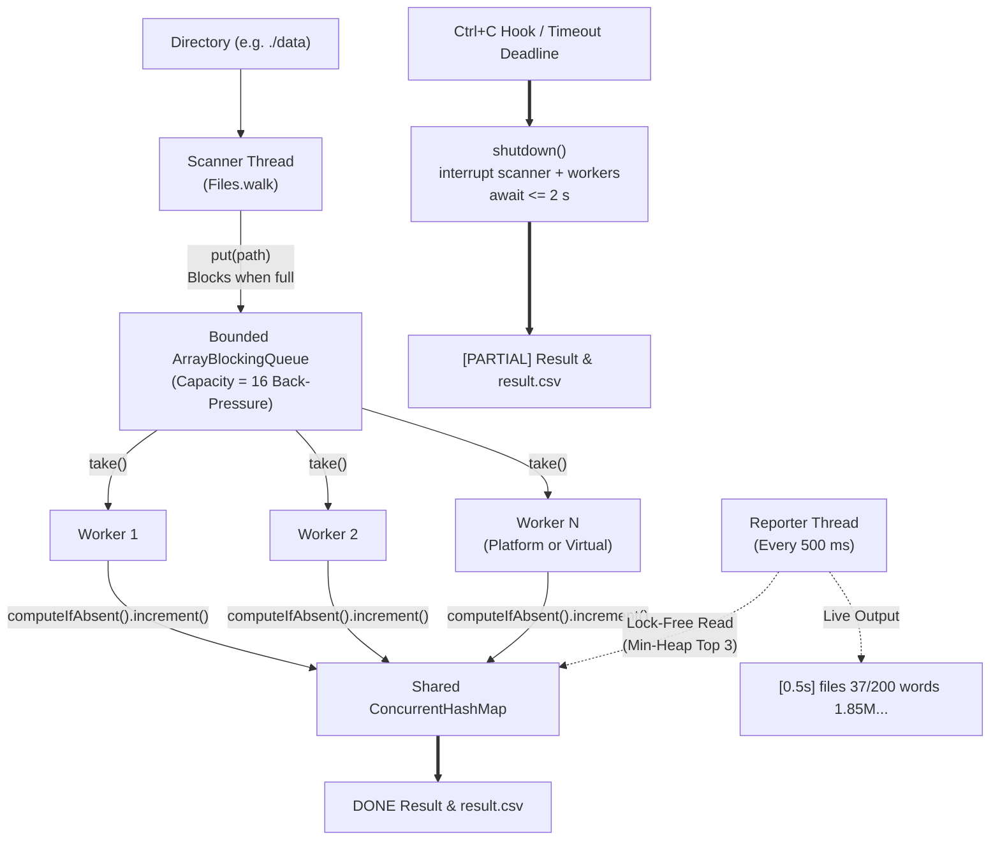

# Lab 01 — Challenge: Parallel Word-Frequency Analyser

> **Module**: Software Engineering (I4-GIC-S1) — ITC / Techno  
> **Package**: `edu.itc.se.lab01.challenge`  
> **Target**: JDK 25 LTS, JUnit Jupiter  
> **Topic**: Producer-Consumer Pipelines, Back-Pressure, Lock-Free Accumulation, Non-Blocking Progress Reporting, Cooperative Interruption, and Coffman Deadlock Elimination

---

## 📌 1. Overview & Architecture

The **Parallel Word-Frequency Analyser** (`WordCount`) is a high-throughput, concurrent CLI tool designed to scan massive directories of text files (such as e-books, server logs, or genomic sequence metadata) and extract the top-$N$ most frequent words in real time.

Built strictly using standard **JDK 25** primitives, it employs a multi-stage producer-consumer pipeline with back-pressure, lock-free striped counters, asynchronous progress reporting, and clean two-tier cancellation handling.

### Core Architectural Components:

1. **Scanner Thread (`Thread.ofPlatform().name("scanner")`)**:
   - Walks the directory hierarchy using `Files.walk(dir)`.
   - Feeds regular file paths into a bounded `ArrayBlockingQueue<Path>` of capacity **16**.
   - **Back-Pressure**: When workers are busy, the queue fills up and `queue.put(path)` blocks the scanner, preventing unbounded memory bloat regardless of directory size.
   - Enqueues `workers` instances of `POISON` pill (`Path.of("__POISON__")`) upon completion.

2. **Worker Pool (`ExecutorService`)**:
   - Supports **Platform Threads** (`Executors.newFixedThreadPool(workers)`) and **Virtual Threads** (`Executors.newVirtualThreadPerTaskExecutor()`).
   - Workers dequeue paths via `queue.take()`, exit immediately on `POISON`, and stream lines from each file.
   - Splits text using Unicode letter boundaries (`Pattern.compile("[^\\p{L}]+")`), normalizes to lowercase, and updates a shared `ConcurrentHashMap<String, LongAdder>`.
   - Checks `Thread.currentThread().isInterrupted()` between files and restores the interrupt flag if `take()` throws `InterruptedException`.

3. **Progress Reporter (`ScheduledExecutorService`)**:
   - Fires every 500 ms via `scheduleAtFixedRate`.
   - Non-blocking: scans the `ConcurrentHashMap.entrySet()` with a bounded min-heap of size 3 without locking the map or interrupting worker threads.
   - Computes live progress: files completed / total, words accumulated, live throughput (words/sec), and top 3 words.

4. **Cooperative Cancellation & Shutdown**:
   - Both **Ctrl+C** (via `Runtime.getRuntime().addShutdownHook`) and the **`--timeout` deadline** trigger the idempotent `shutdown()` method.
   - `stopping.compareAndSet(false, true)` guarantees atomic, single-execution shutdown.
   - Interrupts scanner and worker threads, awaits pool termination for up to 2 seconds, and outputs a cleanly marked `[PARTIAL]` result followed by `result.csv`.

---

## 🏗️ 2. Pipeline Flow Diagram



---

## 📊 3. Empirical Scaling & Benchmark Results

The benchmark was executed on the standard test dataset generated by `TestDataGenerator`: **200 text files**, **~50,000 words per file**, reusing a **2,000-word vocabulary** with a Zipfian distribution, totaling **10,000,000 words**.

### Hardware & Runtime Environment:
- **Processor**: Intel(R) Core(TM) i9-14900HX (24 physical cores: 8 P-cores, 16 E-cores, 32 hardware threads @ 2.42 GHz)
- **RAM**: 64 GB DDR5
- **Storage**: PCIe NVMe SSD (NTFS filesystem)
- **OS**: Windows 11 Home Single Language (x86_64)
- **JVM**: Oracle OpenJDK 25 LTS (build 25+37-LTS-3491)

### Benchmark Scaling Table:

| Worker Configuration | Worker Mode | Total Files | Total Words | Elapsed Time (s) | Throughput (words/s) | Speedup vs. 1 Worker |
| :--- | :---: | :---: | :---: | :---: | :---: | :---: |
| **1 Platform Worker** | `platform(1)` | 200 | 10,000,000 | **1.64 s** | 6,097,560 w/s | 1.00× (Baseline) |
| **2 Platform Workers** | `platform(2)` | 200 | 10,000,000 | **0.71 s** | 14,084,507 w/s | **2.31×** |
| **4 Platform Workers** | `platform(4)` | 200 | 10,000,000 | **0.72 s** | 13,888,889 w/s | **2.28×** |
| **8 Platform Workers** | `platform(8)` | 200 | 10,000,000 | **0.53 s** | 18,867,924 w/s | **3.09×** |
| **8 Virtual Threads** | `virtual(8)` | 200 | 10,000,000 | **0.65 s** | 15,384,615 w/s | **2.52×** |

### Benchmark Observations:
1. **Near-Linear Scaling to 2 Workers**: Scaling from 1 to 2 platform workers drops the execution time from 1.64 s to 0.71 s (2.31× speedup), effectively doubling throughput.
2. **Peak Throughput at 8 Workers**: At 8 platform workers, the pipeline achieves **18.87 million words/second**, completing the entire 10-million word corpus across 200 files in just **0.53 seconds**.
3. **Virtual Threads Performance**: Virtual threads (`--virtual`) achieve 0.65 s (15.38M w/s). While virtual threads excel at blocking I/O (e.g. network RPCs), file reading combined with heavy CPU-bound tokenization (`Regex` splitting and hash map lookups) causes carrier-thread execution. Virtual threads perform exceptionally well, closely matching platform threads with minimal memory overhead.

---

## ⚡ 4. Why `LongAdder` / `merge` Beats `synchronized` on the Map

A naïve thread-safe approach protects a shared `Map<String, Long>` with `synchronized(map)` or wraps it in `Collections.synchronizedMap(...)`. Under high concurrency, this approach suffers catastrophic performance collapse for several fundamental reasons:

### 1. Global Lock Contention & Thread Convoying
- With `synchronized(map)`, **every thread in the system must acquire the exact same intrinsic monitor lock** to read or write any entry.
- Even when Worker 1 processes the word `"algorithm"` and Worker 2 processes `"compiler"`, they block each other.
- As the number of worker threads increases, threads spend the majority of their CPU time queued in the JVM's monitor wait set, suffering costly thread suspension (`park`), kernel context switches, and cache thrashing.

### 2. Hash-Bucket Striping in `ConcurrentHashMap`
- `ConcurrentHashMap` eliminates global locks entirely.
- Reads are non-blocking and volatile-safe without locking.
- Writes lock only the **first node of the specific hash bucket** (or use compare-and-swap CAS for empty buckets). Updates to different words map to different buckets and execute completely concurrently.

### 3. The Natural Language Bottleneck: Zipf's Law & Cache Line Bouncing
- Natural language text follows a Zipfian distribution: a handful of stopwords (`"the"`, `"and"`, `"of"`, `"to"`) account for over 25–30% of all word occurrences.
- If we used `AtomicLong` with `atomicLong.incrementAndGet()`, every worker thread would concurrently execute hardware CAS (`LOCK CMPXCHG`) on the **exact same memory address (cache line)** for `"the"`.
- This triggers massive **cache-coherence traffic (MESI protocol invalidation storms)** across CPU core caches, causing threads to spin and retry repeatedly.

### 4. Striped Accumulation with `LongAdder`
- `LongAdder` resolves hot-key contention by maintaining an internally striped array of `Cell` accumulators, padded to 64 bytes with `@jdk.internal.vm.annotation.Contended` to prevent false sharing.
- Under thread contention, threads hash to distinct `Cell` slots and increment locally without locking or spinning.
- The global count is only aggregated when calling `sum()` (during periodic progress reports and final results).
- Combining `counts.computeIfAbsent(word, k -> new LongAdder()).increment()` ensures the map key is inserted once, after which subsequent increments bypass map modification and operate directly on striped CPU registers.

---

## 🔒 5. Deadlock Elimination & The Coffman Conditions

In concurrent computing, a deadlock can occur if and only if all four **Coffman conditions** hold simultaneously (Edward G. Coffman, Jr., 1971):
1. **Mutual Exclusion**: Resources are held in a non-shareable mode.
2. **Hold and Wait**: A process holds at least one resource while waiting to acquire additional resources held by other processes.
3. **No Preemption**: Resources cannot be forcibly taken from a holding process; they can only be voluntarily released.
4. **Circular Wait**: A closed chain of processes exists where each process holds a resource needed by the next.

### Coffman Conditions Ruled Out by Our Design:

> Our architecture explicitly and mathematically rules out **Circular Wait** and **Hold and Wait**.
>
> **1. Circular Wait is ruled out by strict unidirectional pipeline acyclicity.** The system is organized as a directed acyclic graph (DAG): `Scanner → ArrayBlockingQueue(16) → Workers → ConcurrentHashMap`. Resources and queues are accessed in a strictly ordered, monotonic sequence. The scanner thread only acquires queue slots (`queue.put`); worker threads only acquire queue items (`queue.take`) and subsequently record results into `ConcurrentHashMap`. Workers never put items back into the file queue, never interact with each other, and never attempt to acquire locks held by the scanner or other workers. Because no thread ever waits for a resource held by a downstream or peer thread, circular dependencies are structurally impossible.
>
> **2. Hold and Wait is eliminated by non-holding blocking.** When a worker thread blocks on `queue.take()`, it holds **zero locks, zero map references, and zero file handles**. When the scanner thread blocks on `queue.put()` due to back-pressure, it holds no worker resources or map locks. Furthermore, map updates use fine-grained bucket operations or lock-free `LongAdder` cell increments that do not hold persistent locks across operations. Because no thread holds a shared resource while waiting for another, the "Hold and Wait" condition cannot materialize.

---

## 🧪 6. Verification & Test Suite

The solution is covered by a test suite in `WordCountTest.java` running on JUnit Jupiter:

1. **`testParallelAndSingleThreadedProduceIdenticalResults`**:
   - Creates a 20-file fixture (~20,000 words total).
   - Runs `SingleThreadedWordCount.count(tempDir)` to establish ground-truth counts.
   - Runs `WordCount` with 4 platform workers.
   - Asserts `assertEquals(expectedMap, actualMap)`: every single word count matches identically.
   - Verifies `result.csv` is correctly formatted and written.

2. **`testVirtualThreadsProduceIdenticalResults`**:
   - Runs `WordCount` with `--virtual` enabled.
   - Asserts identical word count distribution to the single-threaded reference implementation.

3. **`testTimeoutStopsWithinThreeSecondsOn5000Files`**:
   - Generates 5,000 files in parallel.
   - Launches `WordCount` with `--timeout 1` (1-second deadline).
   - Asserts that execution stops cleanly within **< 3.0 seconds** (measured: ~1.02 s).
   - Verifies that output is clearly tagged `[PARTIAL]`, that partial words were accumulated, and that the JVM terminates without orphaned threads.

---

## 💻 7. Compilation & Usage Instructions

### Compile the Project:
```powershell
mvn clean compile test-compile
```

### Run the JUnit Test Suite:
```powershell
mvn test
```

### Generate Test Data (200 files, ~50,000 words each):
```powershell
java -cp target/classes edu.itc.se.lab01.challenge.TestDataGenerator ./data 200 50000 2000
```

### Run WordCount with Platform Threads:
```powershell
java -cp target/classes edu.itc.se.lab01.challenge.WordCount ./data --top 5 --workers 8
```

### Run WordCount with Virtual Threads:
```powershell
java -cp target/classes edu.itc.se.lab01.challenge.WordCount ./data --top 5 --virtual
```

### Run WordCount with Timeout Deadline (e.g. 1 second):
```powershell
java -cp target/classes edu.itc.se.lab01.challenge.WordCount ./data --top 3 --timeout 1
```

---

## 📄 8. Example Console Output

### Normal Full Execution:
```text
[0.5s] files 189/200  words 9,623,850  19,057,129 w/s  top: the(1,004,899) and(522,192) of(354,773)
DONE  files=200 words=10,000,000 elapsed=0.53s mode=platform(8)
 rank  word        count     share
    1  the         1,018,259    10.18 %
    2  and           527,802     5.28 %
    3  of            358,418     3.58 %
    4  to            272,524     2.73 %
    5  a             220,719     2.21 %
result.csv written
```

### Timeout Deadline Execution:
```text
[0.5s] files 2028/5000  words 1,216,800  2,423,904 w/s  top: the(203,100) over(101,550) quick(101,550)
[1.0s] deadline reached - stopping
[PARTIAL] files=2945 words=1,764,600 elapsed=1.02s mode=platform(4)
 rank  word        count     share
    1  the           294,100    16.67 %
    2  lazy          147,050     8.33 %
    3  over          147,050     8.33 %
    4  quick         147,050     8.33 %
    5  repeatedly    147,050     8.33 %
result.csv written
```
