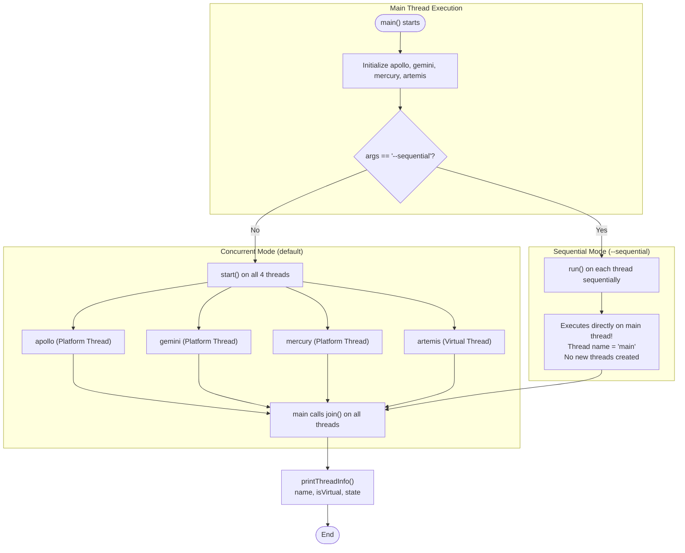

# Lab 01 — Task 1: Thread Creation Mechanisms, Lifecycle States & Virtual Threads

> **Module**: Software Engineering (I4-GIC-S1) — ITC / Techno  
> **Package**: `edu.itc.se.lab01.task1`  
> **Topic**: Thread Creation, Platform vs Virtual Threads (JDK 21+), `start()` vs `run()`, Thread Lifecycle, and Interruption Handling

---

## 📌 1. Overview & Objective

Task 1 demonstrates the fundamental ways to create, manage, and inspect threads in modern Java. It contrasts the 4 primary mechanisms of thread creation, highlights the critical difference between `start()` and `run()`, introduces **Virtual Threads** (Project Loom), and explores thread lifecycle states.

### Key Learning Objectives:
1. **4 Thread Creation Approaches**:
   - Subclassing `java.lang.Thread`
   - Implementing `java.lang.Runnable`
   - Using Lambda expressions
   - Creating Virtual Threads (`Thread.ofVirtual()`)
2. **`start()` vs `run()`**: Understand why calling `run()` directly fails to create a new thread of execution and executes sequentially on the caller's thread (`main`).
3. **Platform vs Virtual Threads**: Compare traditional OS-backed platform threads with lightweight JVM-managed virtual threads.
4. **Thread Lifecycle Inspection**: Use `thread.getState()`, `thread.isVirtual()`, and `thread.join()` to observe states from `NEW` to `TERMINATED`.

---

## 🏗️ 2. Package & Architecture Structure

```
task1/
├── Main.java                               # Mission Control driver (orchestrates launch, join, stats)
├── readme.md                               # Comprehensive documentation
└── src/
    ├── Countdown.java                      # Subclasses Thread; contains countdown logic
    └── CountdownTask.java                  # Implements Runnable; delegates to Countdown.countdown()
```

---

## 🚀 3. Thread Creation Mechanisms Comparison

In [`Main.java`](Main.java), four named mission threads are configured:

```java
// 1. Thread subclassing
Thread apollo  = new Countdown("apollo");

// 2. Implementing Runnable
Thread gemini  = new Thread(new CountdownTask(), "gemini");

// 3. Lambda expression implementing Runnable
Thread mercury = new Thread(() -> { CountdownTask task = new CountdownTask(); task.run(); }, "mercury");

// 4. Virtual Thread (JDK 21+)
Thread artemis = Thread.ofVirtual().name("artemis").unstarted(new CountdownTask());
```

| Mission Thread | Creation Pattern | Implementation Type | Platform / Virtual | Characteristics |
| :--- | :--- | :--- | :--- | :--- |
| **`apollo`** | `new Countdown("apollo")` | Subclass of `Thread` | **Platform** (OS-bound) | Couples task logic to the thread class; Java does not support multiple class inheritance. |
| **`gemini`** | `new Thread(new CountdownTask(), "gemini")` | Implements `Runnable` | **Platform** (OS-bound) | Decouples task (`Runnable`) from execution (`Thread`); preferred OOP practice. |
| **`mercury`** | `new Thread(() -> { ... }, "mercury")` | Lambda `Runnable` | **Platform** (OS-bound) | Concise, inline functional definition; ideal for short-lived tasks. |
| **`artemis`** | `Thread.ofVirtual().name(...).unstarted(...)` | Virtual Thread builder | **Virtual** (JVM-managed) | Lightweight (~few KB), heap-allocated, managed by JVM on carrier threads. |

---

## 🔄 4. Execution Flow Diagram



---

## ⚠️ 5. Critical Concurrency Concepts & Traps

### 1. The `start()` vs. `run()` Trap
- **`thread.start()`**: Requests the JVM and OS to allocate a new call stack and spawn an independent execution thread. The thread enters the `RUNNABLE` state and runs concurrently.
- **`thread.run()`**: Simply executes the method body synchronously on the **current thread** (`main`). No new thread is spawned.

#### Experimental Evidence from [`Main.java`](Main.java):
When executed with `--sequential`, the output clearly proves that:
1. The thread name printed in every countdown line is **`main`**, not the thread's assigned name (`apollo`, `gemini`, etc.):
   ```text
   main: 3
   main: 2
   main: 1
   main: Liftoff!
   ```
2. Because `start()` was never called, all threads remain in the **`NEW`** state even after `join()` returns:
   ```text
   apollo   virtual=false state=NEW
   gemini   virtual=false state=NEW
   mercury  virtual=false state=NEW
   artemis  virtual=true  state=NEW
   ```

---

### 2. Platform Threads vs. Virtual Threads (Project Loom)
- **Platform Threads (`apollo`, `gemini`, `mercury`)**:
  - 1-to-1 mapping with OS kernel threads.
  - Heavy memory footprint (~1 MB reserved stack per thread).
  - Context switching requires kernel transitions.
  - Scale limited to thousands of concurrent threads per system.
- **Virtual Threads (`artemis`)**:
  - Managed entirely by the JVM on the heap.
  - Tiny footprint (few kilobytes initial memory).
  - Mounted/unmounted automatically on a pool of OS carrier threads during blocking operations (e.g. `Thread.sleep()`).
  - Capable of scaling to millions of concurrent threads.

---

### 3. Thread State Machine Inspection
Task 1 inspects states using `thread.getState()`:
```java
private static void printThreadInfo(Thread thread) {
    System.out.printf(
        "%-8s virtual=%-5s state=%s%n",
        thread.getName(),
        thread.isVirtual(),
        thread.getState()
    );
}
```
- In concurrent mode, `join()` blocks `main` until each worker finishes, guaranteeing state transition to **`TERMINATED`**.

---

### 4. Cooperative Interruption Handling
Inside [`Countdown.java`](src/Countdown.java):
```java
try {
    Thread.sleep(200);
} catch (InterruptedException e) {
    Thread.currentThread().interrupt(); // Restore interrupt status flag!
}
```
> [!IMPORTANT]
> When `InterruptedException` is caught, Java clears the interrupt flag. Swallowing the exception without re-interrupting loses the cancellation signal. Calling `Thread.currentThread().interrupt()` properly restores the flag so upstream callers can detect the cancellation request.

---

## 🛠️ 6. How to Build & Run

From directory `lab01-multithreading`:

### 1. Compile
```bash
mvn compile
```

### 2. Run in Concurrent Mode (Default)
```bash
java -cp target/classes edu.itc.se.lab01.task1.Main
```

### 3. Run in Sequential Mode
```bash
java -cp target/classes edu.itc.se.lab01.task1.Main --sequential
```

---

## 📊 7. Comparative Output Analysis

### Mode A: Concurrent (`start()`)
```text
Mission control: all launched
gemini: 3
mercury: 3
apollo: 3
artemis: 3
mercury: 2
gemini: 2
apollo: 2
artemis: 2
artemis: 1
apollo: 1
gemini: 1
mercury: 1
apollo: Liftoff!
gemini: Liftoff!
artemis: Liftoff!
mercury: Liftoff!
Mission control: all landed
apollo   virtual=false state=TERMINATED
gemini   virtual=false state=TERMINATED
mercury  virtual=false state=TERMINATED
artemis  virtual=true  state=TERMINATED
```
- Output from all 4 threads is interleaved due to true concurrent execution.
- Total wall-clock time is ~600 ms (three 200 ms sleeps happening in parallel).
- `artemis` reports `virtual=true`.
- All states are `TERMINATED`.

---

### Mode B: Sequential (`run()`)
```text
main: 3
main: 2
main: 1
main: Liftoff!
main: 3
main: 2
main: 1
main: Liftoff!
main: 3
main: 2
main: 1
main: Liftoff!
Mission control: all launched
Mission control: all landed
apollo   virtual=false state=NEW
gemini   virtual=false state=NEW
mercury  virtual=false state=NEW
artemis  virtual=true  state=NEW
```
- Every step is executed sequentially by the `main` thread.
- Thread name printed is `main`.
- All threads were never started, remaining permanently in `NEW`.
