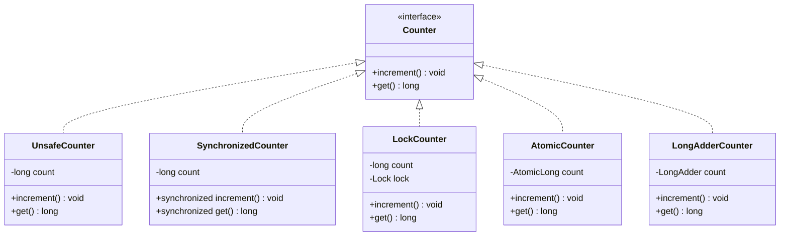

# Lab 01 — Task 2: Race Conditions, Mutual Exclusion & Synchronization Benchmark

> **Module**: Software Engineering (I4-GIC-S1) — ITC / Techno  
> **Package**: `edu.itc.se.lab01.task2`  
> **Topic**: Race Conditions, Thread Safety, Intrinsic Locks, ReentrantLock, Hardware CAS (Atomics), and Striped Accumulators (LongAdder)

---

## 📌 1. Overview & Objective

Task 2 explores the dangers of **shared mutable state** in concurrent programs and evaluates 5 different approaches to thread safety in Java. By running 8 concurrent threads each performing 1,000,000 increments (for an expected total of **8,000,000**), the task benchmarks correctness and execution throughput across various synchronization strategies.

### Key Learning Objectives:
1. **Understand Race Conditions**: See why `count++` is not atomic and causes lost updates under concurrent execution.
2. **Explore Mutual Exclusion (Locking)**:
   - Monitor synchronization with `synchronized` methods.
   - Explicit locking with `ReentrantLock`.
3. **Explore Lock-Free Concurrency**:
   - Compare-And-Swap (CAS) with `AtomicLong`.
4. **High-Throughput Concurrent Accumulation**:
   - Striped cell accumulation with `LongAdder`.
5. **Empirical Benchmarking**: Measure and compare execution time and correctness under heavy thread contention.

---

## 🏗️ 2. Package & Architecture Structure

```
task2/
├── Main.java                               # Benchmark runner & timing harness
├── readme.md                               # Comprehensive documentation
└── src/
    ├── interfaces/
    │   └── Counter.java                    # Base contract: increment() and get()
    └── functions/
        ├── UnsafeCounter.java              # Thread-unsafe (plain long, race condition)
        ├── SynchronizedCounter.java        # Intrinsic monitor locks (synchronized)
        ├── LockCounter.java                # Explicit ReentrantLock (try-finally)
        ├── AtomicCounter.java              # Lock-free AtomicLong (hardware CAS)
        └── LongAdderCounter.java           # Striped accumulator (LongAdder)
```

---

## 🔄 3. Architecture & Class Diagram



---

## 🧩 4. Detailed Implementation Breakdown

### 1. [`Counter`](src/interfaces/Counter.java)
```java
public interface Counter {
    void increment();
    long get();
}
```
Defines the minimal contract for thread-safe accumulator testing.

---

### 2. [`UnsafeCounter`](src/functions/UnsafeCounter.java) *(Thread-Unsafe Baseline)*
```java
public class UnsafeCounter implements Counter {
    private long count = 0;

    @Override public void increment() { count++; }
    @Override public long get() { return count; }
}
```
- **The Bug**: `count++` looks like a single operation, but compiles to 3 distinct bytecode instructions:
  1. `getfield count`: Read the current value from heap into thread register.
  2. `ladd`: Add 1 to the register value.
  3. `putfield count`: Write the new value back to the heap.
- If Thread A and Thread B read the value simultaneously (e.g. `5`), both compute `6` and write back `6`. One increment is completely lost!
- Under 8 threads x 1,000,000 increments, **~30% to 50% of updates are typically lost**.

---

### 💡 The Memory Visibility & `volatile` Question

> **Lab Core Question**: *Would declaring `private volatile long count = 0;` fix the race condition in `UnsafeCounter`? Why or why not?*

**Answer: No, `volatile` will NOT fix this race condition.**

#### Detailed Technical Explanation:
1. **Visibility vs. Atomicity**:
   - `volatile` guarantees **Memory Visibility**: any write to a volatile variable is immediately flushed to main memory, and any read bypasses CPU caches to read the latest value directly from main memory. It also establishes happens-before ordering and prevents compiler reordering.
   - However, `volatile` provides **zero atomicity** for compound actions.
2. **Compound Non-Atomic Execution**:
   - As shown above, `count++` is not a single CPU operation; it is a compound **Read-Modify-Write** sequence:
     $$\text{Read } (count) \longrightarrow \text{Modify } (+1) \longrightarrow \text{Write } (count)$$
3. **The Race Window**:
   - Even if `count` is `volatile`, Thread 1 reads `count` (say, `42`).
   - Before Thread 1 can execute `ladd` and write the result back, Thread 2 also reads `count` from main memory (still `42`).
   - Thread 1 writes `43` to memory (visible immediately).
   - Thread 2 writes `43` to memory (visible immediately).
   - **Result**: Even though visibility was perfect and both writes hit main memory immediately, one increment was completely lost!
4. **When to use `volatile`**:
   - Use `volatile` only for state flags or single-step operations where the new value does *not* depend on the previous value (e.g., `boolean stopRequested = true;` or `volatile Reference config;`).
   - For read-modify-write accumulators, you **must** use mutual exclusion (`synchronized`, `ReentrantLock`), hardware CAS (`AtomicLong`), or striped cells (`LongAdder`).

---

### 3. [`SynchronizedCounter`](src/functions/SynchronizedCounter.java) *(Intrinsic Monitor)*
```java
public class SynchronizedCounter implements Counter {
    private long count = 0;

    @Override public synchronized void increment() { count++; }
    @Override public synchronized long get() { return count; }
}
```
- Uses Java's built-in **intrinsic monitor lock** (`synchronized` on `this`).
- **Guarantees**:
  - **Mutual Exclusion**: Only one thread can execute `increment()` or `get()` at any time.
  - **Memory Visibility**: Changes made in `synchronized` blocks are flushed to main memory upon exiting the monitor (happens-before guarantee).
- **Trade-off**: Heavy contention leads to thread suspension, context switching, and slower throughput.

---

### 4. [`LockCounter`](src/functions/LockCounter.java) *(Explicit ReentrantLock)*
```java
public class LockCounter implements Counter {
    private long count = 0;
    private final Lock lock = new ReentrantLock();

    @Override
    public void increment() {
        lock.lock();
        try {
            count++;
        } finally {
            lock.unlock(); // Always unlock inside finally!
        }
    }

    @Override
    public long get() {
        lock.lock();
        try {
            return count;
        } finally {
            lock.unlock();
        }
    }
}
```
- Uses `java.util.concurrent.locks.ReentrantLock`.
- Provides explicit lock control, fairness policies, and advanced features (`tryLock()`, timed acquisition).
- > [!IMPORTANT]
  > Always release explicit locks inside a `finally` block to ensure release even if an exception occurs.

---

### 5. [`AtomicCounter`](src/functions/AtomicCounter.java) *(Lock-Free CAS)*
```java
public class AtomicCounter implements Counter {
    private final AtomicLong count = new AtomicLong(0);

    @Override public void increment() { count.incrementAndGet(); }
    @Override public long get() { return count.get(); }
}
```
- Uses `java.util.concurrent.atomic.AtomicLong`.
- Implements lock-free synchronization using hardware-level **Compare-And-Swap (CAS)** CPU instructions (e.g., `CMPXCHG` on x86).
- Threads never sleep or block; they retry atomically in a tight loop if another thread beat them to the update.
- Faster than locks under light-to-moderate contention, but can suffer CPU spin contention under heavy concurrency.

---

### 6. [`LongAdderCounter`](src/functions/LongAdderCounter.java) *(Striped Cell Accumulator)*
```java
public class LongAdderCounter implements Counter {
    private final LongAdder count = new LongAdder();

    @Override public void increment() { count.increment(); }
    @Override public long get() { return count.sum(); }
}
```
- Introduced in **Java 8** specifically for high-contention multi-threaded write scenarios.
- **How it works**:
  - Instead of forcing all threads to contend on a single shared variable (like `AtomicLong`), `LongAdder` maintains a dynamically resized array of internal cells (`Cell[]`).
  - Each thread is hashed to a specific cell based on its thread probe, updating its own cell independently without lock contention or cache-line bouncing.
  - Calling `sum()` aggregates the sum across all cells and the base value.
- Produces **dramatically higher throughput** (up to 40x–50x faster than `synchronized`).

---

## 📊 5. Benchmark Comparison & Performance Matrix

Results obtained from running `Main.java` (8 threads, 1,000,000 operations per thread, target = 8,000,000):

| Counter Implementation | Mechanism | Thread-Safe? | Result (Target: 8,000,000) | Elapsed Time | Relative Speed |
| :--- | :--- | :---: | :---: | :---: | :---: |
| **`UnsafeCounter`** | Plain `long` (`count++`) | ❌ **No** | ~5,357,849 *(Lost ~2.6M updates)* | 60 ms | Baseline (Incorrect) |
| **`SynchronizedCounter`** | Monitor lock (`synchronized`) | ✅ **Yes** | 8,000,000 | 595 ms | 1.0x (Slowest safe) |
| **`LockCounter`** | `ReentrantLock` | ✅ **Yes** | 8,000,000 | 205 ms | ~2.9x faster |
| **`AtomicCounter`** | CAS (`AtomicLong`) | ✅ **Yes** | 8,000,000 | 128 ms | ~4.6x faster |
| **`LongAdderCounter`** | Striped Cells (`LongAdder`) | ✅ **Yes** | 8,000,000 | **13 ms** | **~45.7x faster** 🚀 |

### Key Observations & Insights:
1. **UnsafeCounter is hopelessly broken**: Despite completing in 60 ms, it lost more than **33%** of all increment operations due to thread interleaving on non-atomic read-modify-write cycles.
2. **Synchronization overhead is real**: `SynchronizedCounter` is safe but suffers from severe thread contention and monitor locking overhead (595 ms).
3. **ReentrantLock outperforms intrinsic monitor**: In high-throughput contention loops, `ReentrantLock` provides slightly tighter lock dispatch than `synchronized` (205 ms vs 595 ms).
4. **Lock-Free beats Locks**: `AtomicCounter` avoids operating system thread blocking altogether, cutting time down to 128 ms.
5. **LongAdder dominates**: By eliminating contention across threads through internal cell striping, `LongAdder` completes the 8,000,000 increments in just **13 ms**, making it the clear winner for concurrent statistical counters and metrics.

---

## 🛠️ 6. How to Build & Run

From directory `lab01-multithreading`:

### 1. Compile
```bash
mvn compile
```

### 2. Run the Benchmark
```bash
java -cp target/classes edu.itc.se.lab01.task2.Main
```

---

## 💻 7. Example Output

```text
UnsafeCounter          value=5,357,849  correct=false  60 ms
SynchronizedCounter    value=8,000,000  correct=true   595 ms
LockCounter            value=8,000,000  correct=true   205 ms
AtomicCounter          value=8,000,000  correct=true   128 ms
LongAdderCounter       value=8,000,000  correct=true   13 ms
```
