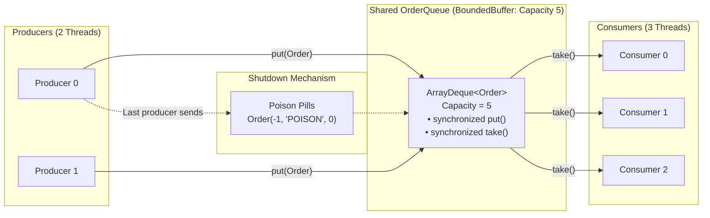

# Lab 01 — Task 3: Multi-Producer Multi-Consumer Pattern with Bounded Buffer

> **Module**: Software Engineering (I4-GIC-S1) — ITC / Techno  
> **Package**: `edu.itc.se.lab01.task3`  
> **Topic**: Concurrency, Thread Synchronization, Monitors (`wait()` / `notifyAll()`), and the Poison Pill Pattern

---

## 📌 1. Overview & Objective

Task 3 implements the classic **Multi-Producer Multi-Consumer (MPMC)** concurrency design pattern. It coordinates multiple independent producer threads producing orders and multiple independent consumer threads processing those orders through a shared, thread-safe bounded buffer.

### Key Objectives:
1. **Thread Synchronization & Mutual Exclusion**: Prevent race conditions when multiple threads concurrently add or remove items from a shared buffer.
2. **Guarded Suspension (Backpressure)**:
   - Producers must block (`wait()`) when the buffer is full until space is made available.
   - Consumers must block (`wait()`) when the buffer is empty until items are produced.
3. **Graceful Shutdown**: Terminate consumer threads reliably without abruptly killing them, using the **Poison Pill Pattern**.
4. **Decoupled Architecture**: Abstract the storage layer using an interface (`OrderQueue`) allowing interchangeable implementations (`BoundedBuffer` vs. `BlockingOrderQueue`).

---

## 🏗️ 2. Package & Architecture Structure

```
task3/
├── Main.java                               # Main entry point and orchestrator
├── Main2.java                              # Alternative entry point / runner
├── readme.md                               # Comprehensive documentation
└── src/
    ├── action/
    │   ├── Order.java                      # Immutable data carrier (record)
    │   ├── Producer.java                   # Producer runnable worker
    │   └── Consumer.java                   # Consumer runnable worker
    ├── interfaces/
    │   └── OrderQueue.java                 # Interface defining put/take operations
    └── process/
        ├── BoundedBuffer.java              # Manual monitor implementation (wait/notifyAll)
        └── BlockingOrderQueue.java         # java.util.concurrent.BlockingQueue wrapper
```

---

## 🔄 3. Workflow & Architecture Diagram



---

## 🧩 4. Detailed Component Breakdown

### 1. [`Order`](src/action/Order.java)
```java
public record Order(int id, String item, int quantity) {}
```
- A Java 16+ immutable record holding:
  - `id`: Unique order identifier (or `-1` indicating a shutdown sentinel).
  - `item`: Description string (e.g., `"item-1"`, `"POISON"`).
  - `quantity`: Number of items ordered.

---

### 2. [`OrderQueue`](src/interfaces/OrderQueue.java)
```java
public interface OrderQueue {
    void put(Order o) throws InterruptedException;
    Order take() throws InterruptedException;
}
```
- An abstraction interface for the bounded buffer:
  - `put(Order o)`: Appends an order to the queue; blocks if the buffer is at capacity.
  - `take()`: Removes and returns the oldest order; blocks if the buffer is empty.
  - Both methods declare `throws InterruptedException` to support thread interruption and cancellation.

---

### 3. [`BoundedBuffer`](src/process/BoundedBuffer.java) *(Core Custom Implementation)*
Implements `OrderQueue` using Java's built-in monitor synchronization (`synchronized`, `wait()`, `notifyAll()`) over an `ArrayDeque<Order>`.

#### Key Implementation Details:
```java
public class BoundedBuffer implements OrderQueue {
    private final ArrayDeque<Order> items = new ArrayDeque<>();
    private final int capacity;

    public BoundedBuffer(int capacity) {
        if (capacity <= 0) throw new IllegalArgumentException("Capacity must be greater than zero.");
        this.capacity = capacity;
    }  

    @Override
    public synchronized void put(Order order) throws InterruptedException {
        while (items.size() == capacity) wait();
        items.addLast(order);
        assert items.size() <= capacity : "Buffer overflow: size exceeds capacity.";
        notifyAll();
    }

    @Override
    public synchronized Order take() throws InterruptedException {
        while (items.isEmpty()) wait();
        Order order = items.removeFirst();
        assert items.size() >= 0 : "Buffer underflow: size is negative.";
        notifyAll();
        return order;
    }
}
```

- **`synchronized` Methods**: Acquires the intrinsic lock of the `BoundedBuffer` instance for mutual exclusion.
- **`while` Guard Condition**:
  - `while (items.size() == capacity) wait();` in `put()`.
  - `while (items.isEmpty()) wait();` in `take()`.

---

### ⚠️ Concurrency Traps: Why `if` and `notify()` Fail

#### Trap 1: Why testing with `if` instead of `while` causes crashes / corruption

```java
// DANGEROUS BUG! DO NOT USE 'if':
if (items.isEmpty()) {
    wait();
}
Order order = items.removeFirst(); // May throw NoSuchElementException!
```

**Step-by-Step Failure Scenario**:
1. Buffer is currently **empty**. Two consumer threads, **Consumer A** and **Consumer B**, both call `take()`. Both see `isEmpty() == true` and enter `wait()`.
2. A producer calls `put()` with **1 item**, inserts it, and invokes `notifyAll()`.
3. Both Consumer A and Consumer B are moved to the `BLOCKED` monitor queue.
4. Consumer A acquires the lock first, returns from `wait()`, calls `items.removeFirst()`, processes the item, and exits the synchronized method. The buffer is now **empty** again!
5. Consumer B now acquires the monitor. **Because Consumer B used `if`**, its execution resumes on the line immediately following `wait()`. It does **not** re-check if items exist!
6. Consumer B unconditionally calls `items.removeFirst()` on an empty `ArrayDeque`, triggering an immediate **`NoSuchElementException`** and crashing the worker!
7. **The Fix**: `while (items.isEmpty()) wait();` forces Consumer B to re-evaluate the condition upon waking. Seeing the buffer is empty, Consumer B safely puts itself back to sleep until another item arrives.

---

#### Trap 2: Why `notify()` instead of `notifyAll()` causes permanent Deadlock ("Lost Notification")

```java
// DANGEROUS BUG! DO NOT USE 'notify()' in MPMC queues:
items.addLast(order);
notify(); // May wake the WRONG thread type!
```

**Step-by-Step Failure Scenario**:
1. Consider a bounded buffer of capacity 1 with 2 Producers ($P_1, P_2$) and 2 Consumers ($C_1, C_2$).
2. The buffer is full (1 item). Both $P_1$ and $P_2$ call `put()`, see capacity is full, and enter `wait()`.
3. $C_1$ calls `take()`, removes the 1 item (buffer is now empty), and calls `notify()`.
4. Inside the JVM's monitor wait set, $P_1, P_2$, and potentially $C_2$ (if it called `take()` when empty) are all waiting in the **same single wait set**.
5. When `notify()` is invoked, the JVM selects **only one thread arbitrarily**.
6. **The Disaster**: The JVM selects $C_2$ instead of $P_1$ or $P_2$!
7. $C_2$ wakes up, checks `items.isEmpty()`, sees the buffer is still empty (because $P_1$ and $P_2$ never ran to produce), and calls `wait()`.
8. Now, $P_1$ is waiting, $P_2$ is waiting, $C_2$ is waiting, and $C_1$ finishes its task and eventually calls `take()` and waits too.
9. **Result**: **All threads in the entire system are now stuck in the `WAITING` state.** No thread is alive to wake them. The program suffers a complete, unrecoverable **deadlock**!
10. **The Fix**: `notifyAll()` wakes **every** thread in the wait set. Even if $C_2$ wakes up and sees an empty queue, $P_1$ and $P_2$ also wake up, recognize space is available, and proceed to fill the buffer.

---

### 4. [`BlockingOrderQueue`](src/process/BlockingOrderQueue.java) *(Standard Library Adapter)*
```java
public final class BlockingOrderQueue implements OrderQueue {
    private final BlockingQueue<Order> queue;

    public BlockingOrderQueue(BlockingQueue<Order> queue) {
        this.queue = queue;
    }

    @Override public void put(Order order) throws InterruptedException { queue.put(order); }
    @Override public Order take() throws InterruptedException { return queue.take(); }
}
```
- Wraps Java's production-ready `java.util.concurrent.BlockingQueue` (such as `ArrayBlockingQueue` or `LinkedBlockingQueue`).
- Demonstrates how the same contract can be met either manually with monitors or via `java.util.concurrent` utilities.

---

### 5. [`Producer`](src/action/Producer.java)
A `Runnable` worker that generates orders and handles shutdown signaling:
- **Order Generation**: Generates `orderCount` orders with unique IDs, names, and randomized quantities (1–5).
- **Latency Simulation**: Sleeps for a random duration between 0 and 20 milliseconds after each item to simulate production latency.
- **Poison Pill Coordination**:
  - Maintains a shared `AtomicInteger finishedProducers`.
  - Inside the `finally` block, each producer executes:
    ```java
    int finished = finishedProducers.incrementAndGet();
    if (finished == producerCount) {
        sendPoisonPills();
    }
    ```
  - The **last producer to finish** injects exactly `consumerCount` poison pills (`Order(-1, "POISON", 0)`) into the queue.
  - This guarantees that every consumer thread will receive exactly one poison pill after all valid orders are inserted.

---

### 6. [`Consumer`](src/action/Consumer.java)
A `Runnable` worker that retrieves and processes orders from the buffer:
- Continuously invokes `queue.take()`.
- **Termination Detection**: Checks if `order.id() == -1`.
  - If true, logs `"consumer-<id> received poison pill, stopping"` and exits its loop.
- **Processing**:
  - Atomically increments the shared `processedCount` counter (`processedCount.incrementAndGet()`).
  - Logs the processed order.
  - Simulates processing delay (`Thread.sleep(0..30 ms)`).
- **Interrupt Safety**: Catches `InterruptedException` and restores the interrupted status via `Thread.currentThread().interrupt()`.

---

### 7. [`Main`](Main.java)
The orchestration driver:
1. Configures:
   - Producers: `2`
   - Consumers: `3`
   - Orders per producer: `50` (Total expected = `100` orders)
   - Buffer capacity: `5`
2. Creates the shared `BoundedBuffer(5)`, `AtomicInteger processedCount`, and `AtomicInteger finishedProducers`.
3. Spawns and starts consumer threads.
4. Spawns and starts producer threads.
5. Awaits completion of all producers via `producer.join()`.
6. Awaits completion of all consumers via `consumer.join()`.
7. Measures elapsed execution time and validates the assertion:
   ```java
   assert total == 100 : "Expected exactly 100 orders";
   ```

---

## ⚡ 5. Concurrency Concepts Demonstrated

| Concept | Where It Is Used | Purpose |
| :--- | :--- | :--- |
| **Mutual Exclusion** | `BoundedBuffer` synchronized methods | Prevents concurrent modification of the underlying `ArrayDeque`. |
| **Condition Synchronization** | `wait()` / `notifyAll()` | Puts threads to sleep when the buffer is full or empty, resuming them upon state change. |
| **Spurious Wakeup Prevention** | `while` loops wrapping `wait()` | Ensures condition is re-verified after waking up before modifying the buffer. |
| **Backpressure / Bounding** | Buffer capacity limit (5) | Throttles producers if consumers fall behind, preventing unbounded memory growth. |
| **Poison Pill Shutdown** | `Order(-1, "POISON", 0)` | Clean, cooperative shutdown mechanism without deprecated methods like `Thread.stop()`. |
| **Atomic Counters** | `AtomicInteger` | Race-condition-free counting across threads for completed producers and processed orders. |
| **Thread Barrier / Joining** | `Thread.join()` | Synchronizes the main thread to wait until all worker threads complete their lifecycles. |
| **Interrupt Flag Restoration** | `Thread.currentThread().interrupt()` | Preserves interruption status when catching `InterruptedException`. |

---

## 🚀 6. How to Build & Run

### Prerequisites
- JDK 21+ (or JDK 25)
- Apache Maven 3.9+

### Using Maven
From the directory `lab01-multithreading`:

1. **Compile**:
   ```bash
   mvn compile
   ```

2. **Run `Main`**:
   ```bash
   # On Windows PowerShell:
   java -cp target/classes edu.itc.se.lab01.task3.Main

   # Or with assertions enabled:
   java -ea -cp target/classes edu.itc.se.lab01.task3.Main
   ```

3. **Run `Main2`**:
   ```bash
   java -cp target/classes edu.itc.se.lab01.task3.Main2
   ```

---

## 📊 7. Example Output

```text
consumer-1 processed Order[id=1, item=item-1, quantity=2]
consumer-0 processed Order[id=51, item=item-51, quantity=5]
consumer-2 processed Order[id=52, item=item-52, quantity=3]
consumer-1 processed Order[id=2, item=item-2, quantity=4]
...
consumer-1 processed Order[id=99, item=item-99, quantity=2]
consumer-0 processed Order[id=48, item=item-48, quantity=2]
consumer-2 processed Order[id=100, item=item-100, quantity=4]
consumer-0 processed Order[id=49, item=item-49, quantity=3]
consumer-2 processed Order[id=50, item=item-50, quantity=2]
consumer-1 received poison pill, stopping
consumer-0 received poison pill, stopping
consumer-2 received poison pill, stopping
Total processed: 100 (expected 100) in 563 ms
```

> **Verification**:
> - All 100 orders are processed across the 3 consumers.
> - Exactly 3 poison pill messages are logged, one per consumer.
> - The program terminates cleanly with 0 deadlocks or hanging threads.
