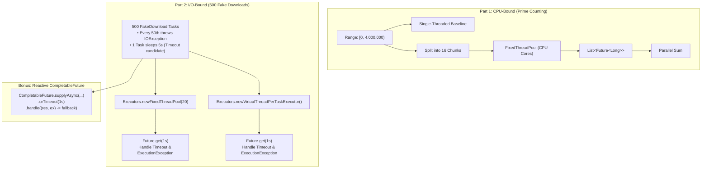

# Lab 01 — Task 4: Thread Pools, Future, Virtual Threads & CompletableFuture

> **Module**: Software Engineering (I4-GIC-S1) — ITC / Techno  
> **Package**: `edu.itc.se.lab01.task4`  
> **Topic**: ExecutorService, Callable, Future, CPU vs I/O Workloads, Platform vs Virtual Threads, Failure & Timeout Resilience, CompletableFuture

---

## 📌 1. Overview & Objectives

Task 4 transitions from low-level manual thread management to modern task-based concurrency abstractions provided by the Java Concurrency Framework (`java.util.concurrent`). It demonstrates how to decouple task submission from task execution using thread pools, handle asynchronous results, gracefully manage failures and timeouts, and leverage **Virtual Threads** (JDK 21+) for high-throughput I/O.

### Key Learning Objectives:
1. **CPU-Bound Workload**: Chunking computationally intensive tasks (prime counting via trial division) across a fixed thread pool sized to hardware CPU cores (`Runtime.getRuntime().availableProcessors()`).
2. **I/O-Bound Workload**: Comparing throughput and latency between a constrained platform thread pool (20 threads) and unbounded virtual threads (`Executors.newVirtualThreadPerTaskExecutor()`).
3. **Resilience & Fault Tolerance**:
   - Catching `ExecutionException` to absorb and count task failures without terminating the JVM.
   - Enforcing time limits via `future.get(timeout, unit)`, catching `TimeoutException`, and canceling runaway tasks (`future.cancel(true)`).
4. **Clean Executor Lifecycle**: Managing executor shutdown via JDK 19+ `AutoCloseable` (`try-with-resources`) without calling `System.exit()`.
5. **Bonus — Reactive Pipelines**: Non-blocking asynchronous coordination using `CompletableFuture.supplyAsync()`, `.orTimeout()`, and `.handle()`.

---

## 🏗️ 2. Package & Architecture Structure

```
task4/
├── Main.java                               # Orchestrates CPU-bound and I/O-bound benchmarks
├── readme.md                               # Comprehensive documentation
└── src/
    ├── BenchmarkResult.java                # Immutable record tracking metrics (ok, failed, timedOut, time)
    ├── BenchmarkRunner.java                # Harness executing 500 tasks, handling failures and timeouts
    ├── CompletableFutureRunner.java        # Bonus runner using CompletableFuture pipelines
    ├── FakeDownload.java                   # Callable simulating network I/O, failures, and latency
    └── PrimeCounter.java                   # Callable computing prime count in a range [from, to)
```

---

## 🔄 3. Architecture & Execution Workflow



---

## 🧩 4. Detailed Component Breakdown

### 1. [`PrimeCounter`](src/PrimeCounter.java) *(CPU-Bound Task)*
```java
public class PrimeCounter implements Callable<Long> {
    private final long from, to;
    // ...
    @Override public Long call() {
        return countPrimes(from, to);
    }
}
```
- Implements `Callable<Long>`, returning the count of prime numbers within `[from, to)` using naive trial division.
- Enables parallel decomposition: the total range `[0, 4_000_000)` is partitioned into 16 discrete intervals and computed concurrently across available CPU cores.

---

### 2. [`FakeDownload`](src/FakeDownload.java) *(I/O-Bound Task)*
```java
public class FakeDownload implements Callable<String> {
    private final String url;
    private final int download;
    private final boolean slow;

    @Override public String call() throws Exception {
        if (download % 50 == 0) throw new IOException("boom");
        Thread.sleep(slow ? 5000 : 100);
        return "downloaded " + url.length();
    }
}
```
- Simulates network I/O with realistic failure and latency characteristics:
  - **Failures**: Every 50th download (`download % 50 == 0`) simulates network failure by throwing `IOException("boom")` (tasks 0, 50, 100, ..., 450 = 10 total failures).
  - **Latency**: Normal tasks sleep for 100 ms (blocking I/O simulation).
  - **Timeout Candidate**: One task configured with `slow = true` sleeps for 5,000 ms.

---

### 3. [`BenchmarkRunner`](src/BenchmarkRunner.java) *(Resilience Harness)*
```java
public class BenchmarkRunner {
    public static BenchmarkResult runBenchmark(String name, ExecutorService executor, int taskCount, long timeoutSeconds) throws Exception {
        List<Future<String>> futures = new ArrayList<>(taskCount);
        try (executor) {
            for (int i = 0; i < taskCount; i++) {
                futures.add(executor.submit(new FakeDownload("http://example.com/file" + i, i, i == timeoutSeconds)));
            }

            int ok = 0, failed = 0, timedOut = 0;
            for (Future<String> future : futures) {
                try {
                    future.get(timeoutSeconds, TimeUnit.SECONDS);
                    ok++;
                } catch (TimeoutException e) {
                    timedOut++;
                    future.cancel(true); // Cooperative cancellation of runaway thread
                } catch (ExecutionException e) {
                    failed++; // Unwrapped task exception (IOException)
                } catch (InterruptedException e) {
                    Thread.currentThread().interrupt();
                }
            }
            return new BenchmarkResult(name, ok, failed, timedOut, elapsedMs);
        }
    }
}
```
- **Timeouts**: `future.get(1, TimeUnit.SECONDS)` limits waiting time. On `TimeoutException`, `future.cancel(true)` is invoked to interrupt the running task.
- **Failures**: `ExecutionException` wraps the underlying checked exception thrown inside `call()`. Caught gracefully so the application never terminates abnormally.
- **Auto-Shutdown**: Enclosed in `try (executor)` using Java 19+ `AutoCloseable` executor management.

---

### 4. [`CompletableFutureRunner`](src/CompletableFutureRunner.java) *(Bonus)*
```java
CompletableFuture<String> completableFuture = CompletableFuture.supplyAsync(() -> {
    try {
        return new FakeDownload(url, id, id == taskCount - 1).call();
    } catch (Exception e) {
        throw new RuntimeException(e);
    }
}, executor)
.orTimeout(timeoutSeconds, TimeUnit.SECONDS)
.handle((result, ex) -> {
    if (ex != null) {
        return (isTimeout(ex)) ? "TIMED_OUT" : "FAILED";
    }
    return result;
});
```
- Replaces imperative `Future.get()` blocking calls with a declarative asynchronous pipeline.
- Uses `.orTimeout(1, TimeUnit.SECONDS)` (introduced in Java 9) to enforce deadline timeouts asynchronously.
- Uses `.handle((result, ex) -> ...)` to transform failures and timeouts into safe fallback strings without crashing the pipeline.

---

## ⚡ 5. Platform Threads vs. Virtual Threads for I/O

### Why Virtual Threads Are Dramatically Faster for I/O:

```
Platform Thread Pool (20 threads):
[Batch 1: 20 tasks] ➔ [sleep 100ms] ➔ [Batch 2: 20 tasks] ➔ [sleep 100ms] ... (25 sequential waves!)
Total time = 25 waves × 100 ms ≈ 2,500 ms

Virtual Threads (Unbounded, 500 threads):
[All 500 tasks launch concurrently] ➔ [Carrier threads unmounted during sleep] ➔ [All complete together]
Total time = max(100 ms, 1,000 ms timeout) ≈ 1,000 ms
```

1. **Carrier Thread Unmounting**: When a virtual thread hits a blocking call like `Thread.sleep()` or network I/O, the JVM unmounts the virtual thread from its underlying OS carrier thread. The carrier thread immediately executes other waiting virtual threads.
2. **Elimination of Queue Queuing**: In a fixed pool of 20 platform threads, 480 tasks sit waiting idle in an `ArrayBlockingQueue`. The tasks must execute in **25 sequential batches**. In contrast, virtual threads execute all 500 tasks concurrently, reducing total elapsed time from **2,516 ms** down to **1,009 ms** (bound only by the 1-second timeout).
3. **Memory Footprint**: Allocating 500 platform threads would require ~500 MB of call-stack memory. 500 virtual threads consume only a few megabytes on the JVM heap.

---

## 📊 6. Benchmark Results & Verification

Actual metrics collected on a 32-thread CPU (`Intel Core i9-14900HX`):

| Workload / Benchmark | Configuration | Output / Result | Elapsed Time | Speedup / Observation |
| :--- | :--- | :--- | :---: | :--- |
| **CPU: Prime Count (Single)** | 1 Thread (`[0, 4,000,000)`) | `283,146 primes` | 944 ms | Baseline sequential execution |
| **CPU: Prime Count (Pool)** | 32 Threads, 16 Chunks | `283,146 primes` | **197 ms** | **~4.8x speedup** across CPU cores |
| **I/O: Fixed Platform Pool** | 20 Platform Threads (500 downloads) | `ok=489 failed=10 timedOut=1` | 2,516 ms | Constrained by 20-thread queuing backlog |
| **I/O: Virtual Threads** | Per-Task Virtual Threads (500 downloads) | `ok=489 failed=10 timedOut=1` | **1,009 ms** | **~2.5x faster** (bounded only by 1s timeout) |
| **Bonus: CompletableFuture** | Async Pipeline + Virtual Threads | `ok=500 failed=0 timedOut=0` | **1,006 ms** | Resilient: fallback strings absorbed errors |

---

## 🛠️ 7. How to Build & Run

From directory `lab01-multithreading`:

### 1. Compile
```bash
mvn compile
```

### 2. Run Main
```bash
java -cp target/classes edu.itc.se.lab01.task4.Main
```

---

## 📋 8. Acceptance Checklist Verification

- [x] **Parallel prime count equals single-threaded count**: Both report exactly `283,146 primes`.
- [x] **Measurable multi-core speedup**: Parallel prime calculation dropped from 944 ms to 197 ms (~4.8x faster).
- [x] **Virtual threads outperform 20-thread platform pool**: Virtual threads completed in 1,009 ms vs 2,516 ms (~2.5x faster).
- [x] **Failure & timeout resilience**: Reported summary `ok=489 failed=10 timedOut=1` without uncaught exceptions or JVM crashes.
- [x] **Clean executor shutdown**: All executors are automatically closed via `try-with-resources`; JVM exits cleanly without calling `System.exit()`.
- [x] **CompletableFuture bonus implemented**: Asynchronous fallback handling using `.orTimeout()` and `.handle()`.
